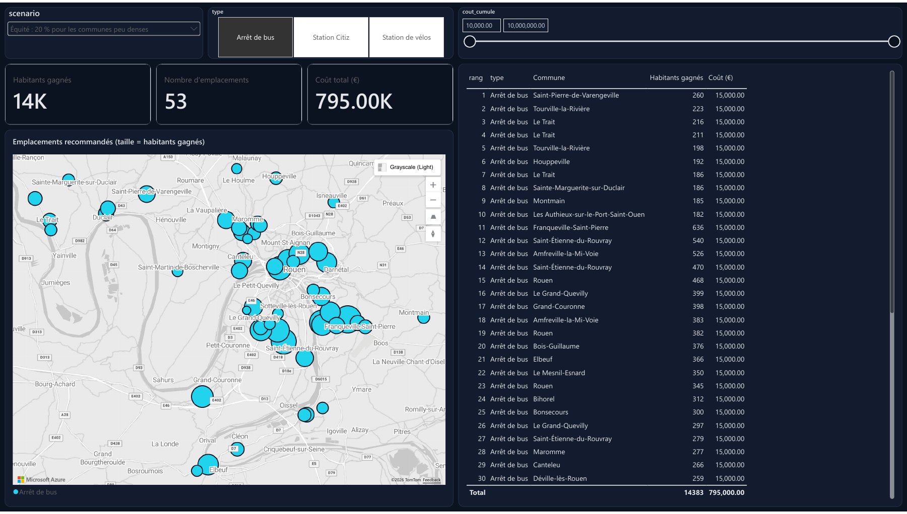
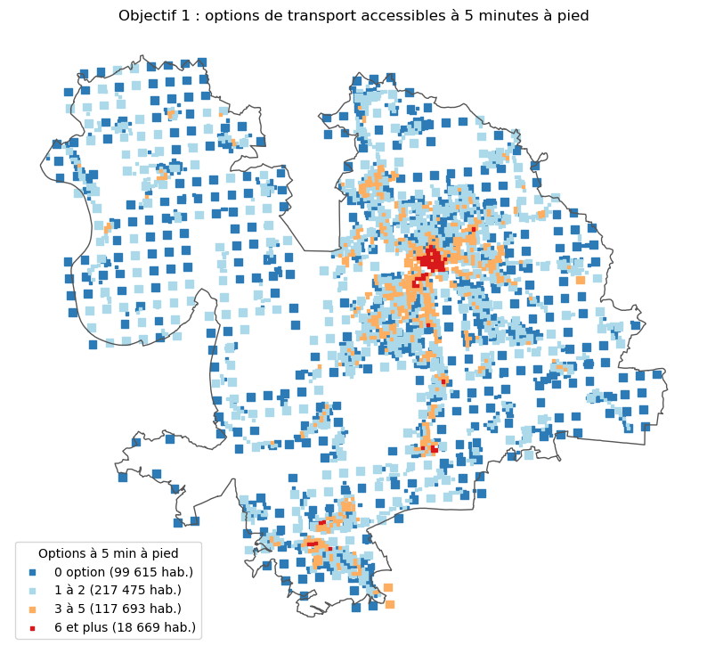
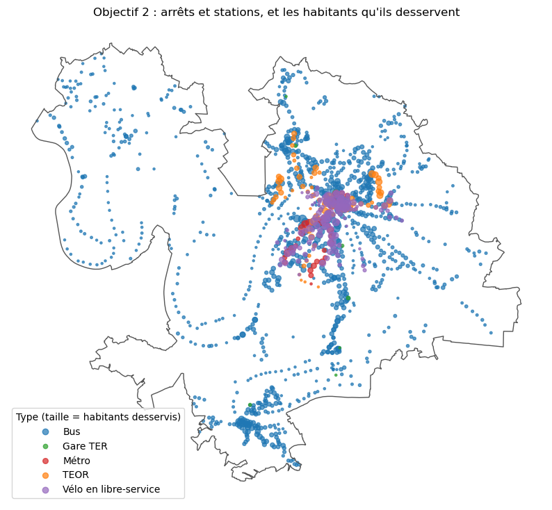
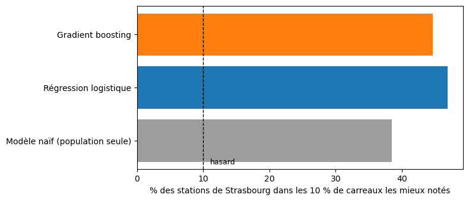
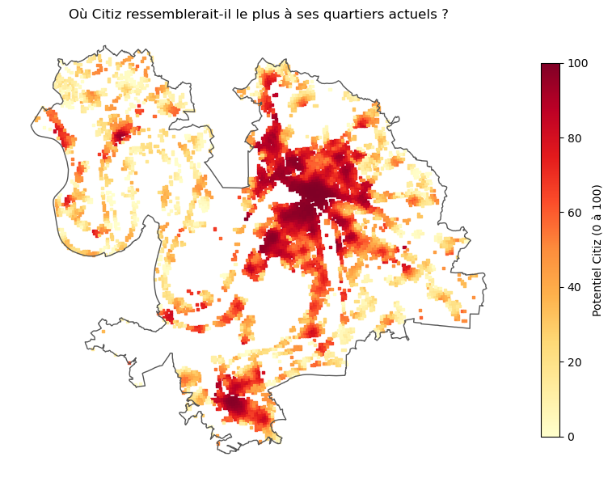
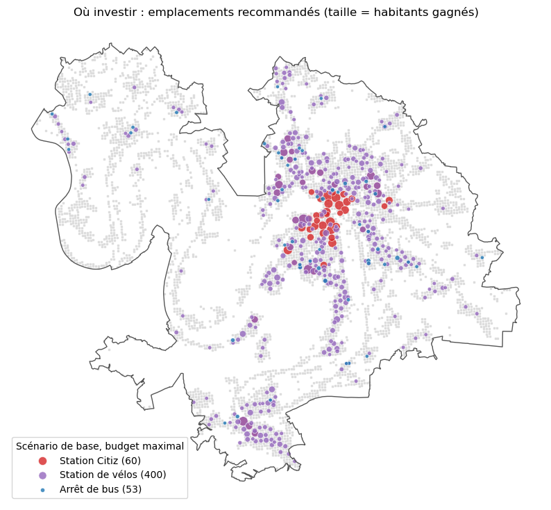

# Hackathon Mobility · Dream Team

Outil d'aide à la décision pour identifier les zones d'implantation prioritaires des futures stations d'autopartage **Citiz**, construit de bout en bout dans Microsoft Fabric : Lakehouse, notebooks, MLflow et Power BI.

**En bref.** 78 % des 453 452 habitants de la Métropole Rouen Normandie ont une option de transport à 5 minutes à pied. Avec 1,5 M€, 60 stations Citiz mettraient 129 618 habitants à moins de 5 minutes d'une voiture partagée, d'abord à Rouen, au Petit-Quevilly et à Elbeuf. Le modèle qui guide ce choix, testé sur Strasbourg, place 46,9 % des vraies stations dans les 10 % de carreaux les mieux notés, contre 38,5 % pour la population seule.



---

## 🎯 Cadrage & Méthodologie

* **Territoires :**
  * **Eurométropole de Strasbourg :** terrain d'expérimentation et de validation du modèle (33 communes, 185 stations Citiz).
  * **Métropole Rouen Normandie :** cas d'application final, la vitrine (71 communes, 453 452 habitants, aucune station Citiz).
* **Approche :** entraîner le modèle sur les villes déjà couvertes par Citiz (1 615 stations, 15 réseaux), valider la méthodologie sur Strasbourg, puis projeter les recommandations sur Rouen.
* **Unité d'analyse :** carreau INSEE de 200 m (Filosofi 2021). Les carreaux de moins de 11 ménages sont regroupés en mailles de 1 km sur les cartes publiques.
* **Accessibilité piétonne :** 5 minutes à pied = 400 m réels sur le réseau viaire OpenStreetMap, autoroutes exclues.
* **Règle de comptage des offres :** une option correspond à un arrêt ou une station (une gare compte une seule fois). La Métropole en compte 1 288 : 1 053 arrêts de bus, 70 arrêts TEOR, 31 stations de métro, 8 gares TER et 126 stations Lovélo.
* **Données :** uniquement des données ouvertes, aux formats de référence GTFS et GBFS pour les transports. Le détail est dans [SOURCES.md](SOURCES.md).

### Les trois étapes

1. **Diagnostic (objectifs 1 et 2).** Pour chaque carreau, les options de transport à 5 minutes à pied ; pour chaque option, les habitants qu'elle dessert.
2. **Modèle de potentiel Citiz.** Une régression logistique apprend à reconnaître les quartiers où Citiz est installé, à partir de 12 variables calculées dans un rayon de 400 m : population, âges, revenus, ménages, logement, arrêts de transport. Elle est testée sur Strasbourg, exclue de l'apprentissage, puis note chaque carreau de Rouen de 0 à 100.
3. **Optimisation sous budget (objectif 3).** Un algorithme glouton choisit à chaque tour l'emplacement qui touche le plus d'habitants pas encore desservis par euro, avec un budget par type d'équipement. Cinq scénarios : base, équité, coûts hauts, coûts bas, et sans le modèle.

---

## 📊 Résultats

### Objectif 1 : qui a une option de transport à 5 minutes à pied ?

**78 % des habitants ont au moins une option de transport à 5 minutes à pied**, et 1,9 en moyenne. Les 22 % restants, soit environ 100 000 habitants, n'en ont aucune.

| Options à 5 minutes | Habitants |
| --- | ---: |
| Aucune | 99 615 |
| 1 à 2 | 217 475 |
| 3 à 5 | 117 693 |
| 6 et plus | 18 669 |

Répartition de la carte publique, où les petits carreaux sont regroupés en mailles de 1 km.

Sur la carte, chaque carreau est coloré du plus froid au plus chaud : bleu foncé sans aucune option, bleu clair pour 1 à 2, orange pour 3 à 5, rouge pour 6 et plus. Le cœur de Rouen est chaud, la périphérie froide. Les communes au plus fort potentiel de développement sont Berville-sur-Seine (81 % des habitants sans option à 5 minutes), Anneville-Ambourville (71 %), Saint-Aubin-Celloville (70 %), Quévreville-la-Poterie (63 %) et Gouy (59 %).



### Objectif 2 : combien d'habitants chaque option dessert-elle ?

**Le bus dessert le plus d'habitants : 296 720, soit 65 % de la Métropole.** Une station de métro dessert pourtant en médiane 1 552 habitants, près de cinq fois plus qu'un arrêt de bus.

| Type d'option | Nombre | Habitants par option (médiane) | Habitants desservis au total |
| --- | ---: | ---: | ---: |
| Bus | 1 053 | 330 | 296 720 |
| Vélo en libre-service (Lovélo) | 126 | 1 434 | 102 780 |
| TEOR | 70 | 1 058 | 63 232 |
| Métro | 31 | 1 552 | 45 017 |
| Gare TER | 8 | 342 | 3 700 |

La dernière colonne compte chaque habitant une seule fois, même s'il a plusieurs options du même type à 5 minutes.



### Le modèle, testé sur Strasbourg

Le modèle apprend sur 56 631 carreaux de 14 réseaux Citiz. Il est testé sur les 2 160 carreaux des communes de l'Eurométropole où Citiz est présent, dont 179 ont une station.

| Méthode | AUC | Stations dans le top 10 % | Gain sur le hasard |
| --- | ---: | ---: | ---: |
| Régression logistique (modèle principal) | 0,83 | 46,9 % | × 4,7 |
| Gradient boosting (comparaison) | 0,81 | 44,7 % | × 4,5 |
| Modèle naïf : population seule | 0,79 | 38,5 % | × 3,8 |
| Hasard | 0,50 | 10 % | × 1 |

En acceptant une station dans un carreau voisin, la régression logistique en retrouve 61,5 %, 3,6 fois mieux que le hasard, contre 2,8 fois pour le modèle naïf. Le modèle principal a été choisi avant le test, parce qu'on peut expliquer ses poids : les quartiers où Citiz est installé comptent plus de ménages d'une personne et d'habitat collectif, moins de propriétaires et moins de ménages pauvres. Les essais sont suivis dans l'expérience MLflow `citiz_test_strasbourg`.



Appliqué à Rouen, le modèle désigne surtout Rouen et les communes denses qui l'entourent, ainsi que l'agglomération d'Elbeuf, au sud.



### Objectif 3 : où investir ?

**Avec 1,5 M€, 60 stations Citiz mettraient 129 618 habitants à moins de 5 minutes à pied d'une voiture partagée.** Scénario de base, coûts moyens, budget maximal :

| Équipement | Budget maximal | Coût unitaire | Emplacements | Habitants nouvellement à 5 minutes |
| --- | ---: | ---: | ---: | ---: |
| Stations Citiz | 1 500 000 € | 25 000 € | 60 | 129 618 |
| Stations de vélos | 10 000 000 € | 25 000 € | 400 | 257 537 |
| Arrêts de bus | 800 000 € | 15 000 € | 53 | 14 383 |

Les premières stations Citiz vont à Rouen, au Petit-Quevilly, à Elbeuf, au Grand-Quevilly, à Sotteville-lès-Rouen et à Saint-Étienne-du-Rouvray. Les budgets sont des plafonds : dans la démo, le curseur montre ce que finance un budget plus petit.

* **Coûts :** selon la fourchette retenue, 1,5 M€ financent 46 à 75 stations Citiz, qui touchent 110 181 à 148 185 habitants. Le coût étant le même pour tous les emplacements d'un type, l'ordre de priorité ne change pas.
* **Équité :** réserver 20 % du budget aux communes peu denses fait passer les habitants touchés par les stations Citiz de 129 618 à 118 718, soit 8 % de moins.
* **Apport du modèle :** 52 des 60 stations sont les mêmes avec ou sans la note de potentiel. Le modèle remplace les 8 autres par des quartiers plus proches du profil Citiz, pour 1 203 habitants de moins.



### Impact, en ordre de grandeur

Autour des 1 604 stations Citiz existantes, 3 315 456 habitants vivent à moins de 400 m. Rapporté aux 130 000 conducteurs Citiz, le taux d'adhésion est donc de 3,9 % au plus. Les 129 618 habitants touchés à Rouen donneraient au plus 5 081 conducteurs, soit environ 110 voitures partagées à raison de 46 conducteurs par voiture. Une voiture en autopartage remplaçant 5 à 8 voitures personnelles (ADEME, 2022), ce serait 550 à 880 voitures personnelles en moins. Ce sont des maximums : une partie des conducteurs actuels vit à plus de 400 m d'une station.

Selon le scénario central des projections Omphale de l'INSEE, la Seine-Maritime passerait de 1 249 000 habitants en 2026 à 1 226 000 en 2040, et la part de ses 65 ans et plus de 19,6 % en 2018 à 28,2 % en 2070.

---

## 🖥️ La démo

| Fichier | Contenu | Comment l'ouvrir |
| --- | --- | --- |
| `demo/rapport_powerbi.pdf` | Le rapport Power BI en 4 pages : qui a accès, qui est concerné, où investir, le modèle est-il fiable | Directement sur GitHub |
| `demo/carte_acces_5min.html` | Carte interactive des options de transport à 5 minutes à pied | Télécharger, puis ouvrir dans un navigateur |
| `images/powerbi_*.png` | Une capture par page du rapport | Directement sur GitHub |
| `notebooks_html/` | Les notebooks avec leurs résultats, tels qu'exportés de Fabric | Télécharger, puis ouvrir dans un navigateur |

---

## 📁 Structure du projet

```text
├── notebooks/       # 10 notebooks Fabric (.ipynb), avec leur code et leurs résultats
├── notebooks_html/  # les notebooks 00 à 20 exportés en HTML depuis Fabric
├── demo/            # rapport Power BI (PDF) et carte interactive (HTML)
├── images/          # cartes des notebooks et captures du rapport
├── slides/          # support de soutenance
├── SOURCES.md       # répertoire des sources de données et métadonnées
└── README.md
```

| Notebook | Ce qu'il fait | Ce qu'il produit |
| --- | --- | --- |
| 00 | Stations Citiz (15 réseaux) et Lovélo, depuis les flux GBFS ; relevé des voitures disponibles | fichiers dans `Files/brut/gbfs` |
| 01 | Téléchargements : Filosofi, arrêts, GTFS Astuce, Omphale, contours IGN | fichiers dans `Files/brut` |
| 02 | Carreaux et options de transport de Rouen | `carreaux_rouen`, `options_rouen`, `carreaux_sur_lignes` |
| 03 | Zones de 5 minutes à pied sur le réseau OpenStreetMap | `zones_5min`, `couverture_candidats` |
| 04 | Objectifs 1 et 2, cartes | `carte_acces`, `acces_communes` |
| 10 | Variables du modèle : villes Citiz, Strasbourg, Rouen | `carreaux_apprentissage`, `variables_rouen` |
| 11 | Test du modèle sur Strasbourg, expérience MLflow | `resultats_modele`, `importance_variables` |
| 12 | Potentiel Citiz des carreaux de Rouen, taux d'adhésion | `scores_rouen`, `stats_citiz` |
| 20 | Choix des emplacements sous budget, 5 scénarios | `recommandations_rouen`, `synthese_scenarios` |
| 21 | Construction du rapport Power BI par l'API Fabric (facultatif) | le rapport « Demo mobilite Rouen » |

---

## ▶️ Relancer le projet dans Microsoft Fabric

1. Créer un espace de travail et un Lakehouse nommé `mobilite`.
2. Déposer l'extrait OpenStreetMap Haute-Normandie de Geofabrik (`.gpkg.zip`) dans `Files/brut/osm`, sans le décompresser.
3. Importer les notebooks du dossier `notebooks` et attacher le Lakehouse `mobilite` à chacun.
4. Les exécuter dans l'ordre : 00, 01, 02, 03, 04, 10, 11, 12, 20.
5. Créer un modèle sémantique avec `carte_acces`, `acces_communes`, `options_rouen`, `recommandations_rouen` et `resultats_modele`. Construire ensuite le rapport à la main, ou avec le notebook 21 en remplaçant les identifiants du rapport et du modèle.

---

## ⚠️ Limites

* Le modèle apprend où Citiz s'est déjà installé, pas une demande mesurée : un carreau sans station n'est pas forcément mauvais (« PU learning »).
* La population est celle des ménages fiscaux de Filosofi 2021, pas celle du recensement.
* Le fichier national d'arrêts (version du 13 janvier 2026) ne donne ni le mode ni la fréquence des passages.
* Le relief de Rouen n'est pas pris en compte dans les temps de marche.
* Les coûts sont des fourchettes tirées de sources publiques (voir [SOURCES.md](SOURCES.md)), à confirmer avec Citiz et la Métropole. Un même coût s'applique à tous les emplacements d'un type.
* Le taux d'adhésion est un maximum : l'impact est un ordre de grandeur.
* Selon l'ADEME, l'impact environnemental national de l'autopartage n'est pas encore significatif, faute de volume.

---

## 👥 Équipe

Dream Team, 5 personnes : 3 profils data (diagnostic, modèle, optimisation et impact) et 2 profils dev (plateforme Fabric et GitHub, démo Power BI).
